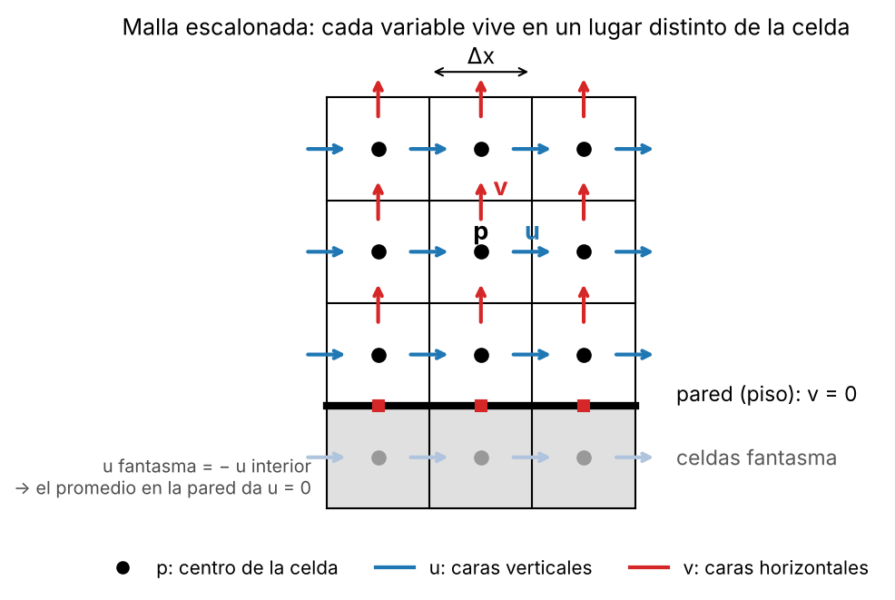
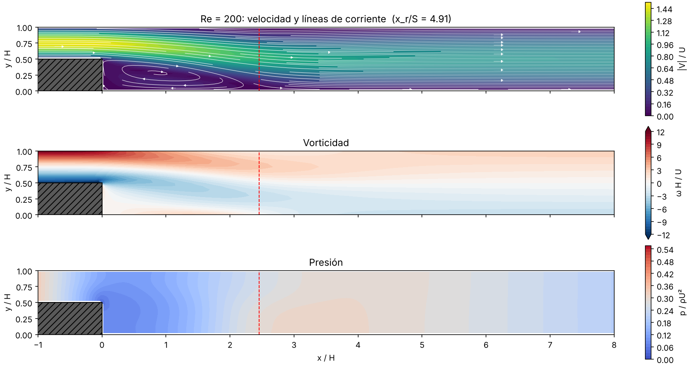
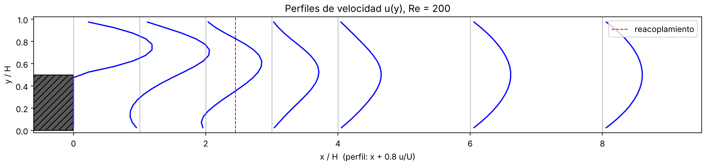
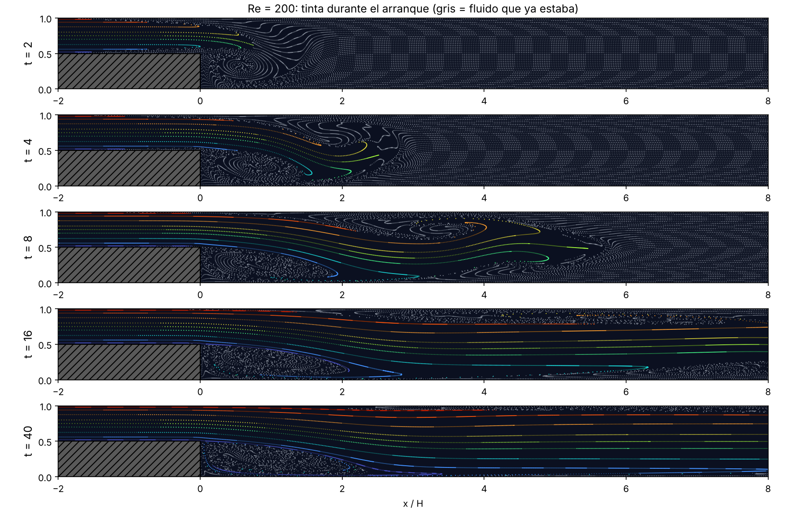
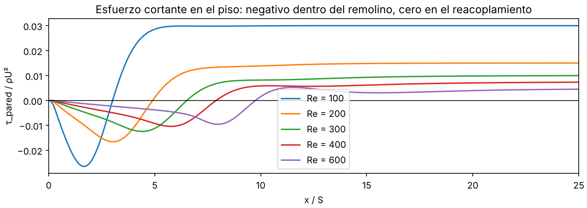
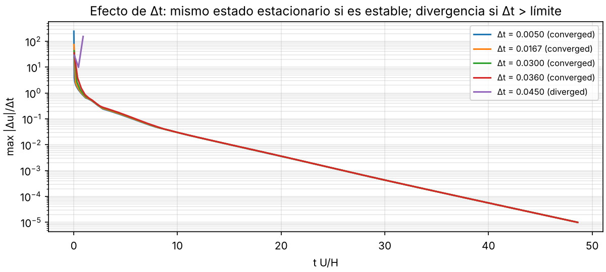

<div class="video">
**Video (YouTube):** <https://www.youtube.com/shorts/1UjPvbtYBLU>  
**Código:** `escalon_descendente.ipynb` (Ejecutar todo: ~13 min con videos, ~5 min sin ellos)  
**Videos de la simulación:** `figures/arranque_re200.mp4` y `figures/comparacion_re.mp4` · **Video del proyecto (2:39):** `video/video_proyecto.mp4`
</div>

## Resumen

Se simula el flujo bidimensional, incompresible y laminar en un canal con un escalón descendente de relación de
expansión 2, para números de Reynolds de 100 a 600. Las ecuaciones de Navier–Stokes se resuelven con un código propio
en Python: volúmenes finitos de segundo orden en malla escalonada (MAC), método de proyección de Chorin con
Adams–Bashforth de segundo orden y ecuación de Poisson para la presión resuelta por factorización LU dispersa. El código
conserva la masa a precisión de máquina ($\max|\nabla\cdot\mathbf u|\sim10^{-14}$) y su resultado cambia menos de 1 % al
duplicar la malla. La longitud de reacoplamiento $x_r$ crece casi linealmente con $Re$ ($x_r/S$ = 2.84, 4.91, 6.73, 8.26,
9.40, 10.06 para $Re$ = 100–600) y desde $Re\approx400$ aparece una burbuja secundaria en la pared superior. Se presenta un
análisis paramétrico de viscosidad (Re), malla y paso de tiempo, se compara con la literatura (diferencias de 2 % o menos
para $200\le Re\le600$) y se visualiza el arranque del flujo con partículas trazadoras (tinta virtual).

## 1. Introducción y descripción del fenómeno

El escalón descendente (*backward-facing step*, BFS) es el caso de prueba clásico de flujo separado: la geometría es
simple, pero el flujo tiene separación, recirculación, capa de corte libre y reacoplamiento, los mismos mecanismos que
aparecen en difusores, cámaras de combustión, intercambiadores y la parte trasera de vehículos.

Cuando el fluido llega a la esquina convexa, la capa límite no puede seguir el cambio brusco de geometría porque el
fluido cercano a la pared no tiene inercia para vencer el gradiente de presión adverso de la expansión. El flujo se
**separa** en la arista y forma una **capa de corte** con vorticidad intensa. Debajo de ella queda una **burbuja de
recirculación** con flujo inverso. La capa de corte se ensancha por difusión viscosa hasta tocar la pared inferior en
el **punto de reacoplamiento** $x_r$, donde el esfuerzo cortante en la pared cambia de signo ($\tau_w=0$). Aguas
abajo el perfil de velocidad se reorganiza en una parábola de Poiseuille que ocupa todo el canal.

Al aumentar $Re$ (menos viscosidad), el momento de la capa de corte se difunde más lento hacia la pared y la burbuja se
alarga. Para $Re\gtrsim400$, el gradiente de presión adverso es suficiente para separar también la capa límite de la
pared superior y aparece una **burbuja secundaria** (Armaly et al., 1983).

## 2. Planteamiento físico

### 2.1 Geometría y adimensionalización

Altura del canal aguas abajo $H$, altura del escalón $S=H/2$ y canal de entrada $h=H-S$, por lo que la relación de
expansión es $ER=H/h=2$. Antes del escalón hay un canal de entrada de largo $2H$; el dominio es $-2H\le x\le L$,
$0\le y\le H$, con $L=15H$ a $25H$ según $Re$, y el escalón es el bloque sólido $x<0$, $y<S$. El canal de entrada deja que el
perfil se deforme antes de la esquina, como en el flujo real; sin él, la burbuja sale ~8 % más larga a $Re=200$ (lo
verificamos con el mismo código).

Se usa la velocidad media de entrada $U$, la altura $H$ y la presión dinámica $\rho U^2$ como escalas. El número de
Reynolds es
$$Re=\frac{UH}{\nu}=\frac{U\,(2h)}{\nu},$$
es decir, basado en el diámetro hidráulico del canal de entrada (definición de Armaly et al. y de Gartling).
Con $U=H=1$, $\nu=1/Re$: **variar la viscosidad es variar $Re$**.

### 2.2 Ecuaciones de gobierno

$$\nabla\cdot\mathbf u=0$$
$$\frac{\partial\mathbf u}{\partial t}+(\mathbf u\cdot\nabla)\mathbf u=-\nabla p+\frac1{Re}\nabla^2\mathbf u$$

En componentes y en forma conservativa (la que se discretiza):
$$\frac{\partial u}{\partial t}+\frac{\partial (u^2)}{\partial x}+\frac{\partial (uv)}{\partial y}=-\frac{\partial p}{\partial x}+\frac1{Re}\left(\frac{\partial^2u}{\partial x^2}+\frac{\partial^2u}{\partial y^2}\right)$$
$$\frac{\partial v}{\partial t}+\frac{\partial (uv)}{\partial x}+\frac{\partial (v^2)}{\partial y}=-\frac{\partial p}{\partial y}+\frac1{Re}\left(\frac{\partial^2v}{\partial x^2}+\frac{\partial^2v}{\partial y^2}\right)$$

### 2.3 Supuestos de modelado

1. Flujo bidimensional (canal infinitamente ancho en $z$).
2. Incompresible, $\rho$ constante; fluido newtoniano con $\mu$ constante; isotérmico.
3. Laminar ($Re\le600$); la transición en el BFS ocurre alrededor de $Re\approx1200$ (Armaly et al.).
4. Sin fuerzas de cuerpo: la gravedad sólo añade una presión hidrostática que no cambia la cinemática.

### 2.4 Condiciones iniciales y de frontera

| Frontera | Velocidad | Presión |
|---|---|---|
| Entrada $x=-2H$, $S<y<H$ | Poiseuille $u=6U\eta(1-\eta)$, $\eta=(y-S)/h$; $v=0$ | $\partial p/\partial n=0$ |
| Escalón: tapa $y=S$ y cara $x=0$ | no deslizamiento $u=v=0$ | $\partial p/\partial n=0$ |
| Paredes $y=0$ y $y=H$ | no deslizamiento $u=v=0$ | $\partial p/\partial n=0$ |
| Salida $x=L$ | $\partial u/\partial x=\partial v/\partial x=0$ | $p=0$ |

**Condición inicial:** fluido en reposo, $\mathbf u(x,y,0)=0$. Se integra en el tiempo hasta alcanzar el estado
estacionario. El perfil de entrada tiene velocidad media $U$ y máxima $1.5U$.

## 3. Método numérico

### 3.1 Malla escalonada (MAC)

La presión se almacena en el centro de cada celda, $u$ en las caras verticales y $v$ en las horizontales. Así el
gradiente de presión que mueve cada velocidad usa dos nodos vecinos directos y se evita el desacople
presión–velocidad ("tablero de ajedrez") sin necesidad de correcciones adicionales. Las condiciones de no deslizamiento para la
componente tangencial se imponen con celdas fantasma ($u_{fantasma}=-u_{interior}$), tanto en piso y techo como en la
tapa y la cara del escalón. Las celdas dentro del escalón se excluyen de la ecuación de presión.

{width=55%}

### 3.2 Método de proyección (paso fraccionado de Chorin)

Con $\mathbf R(\mathbf u)=\tfrac1{Re}\nabla^2\mathbf u-\nabla\cdot(\mathbf u\mathbf u)$, cada paso de tiempo hace:

1. **Predictor (Adams–Bashforth 2):** $\mathbf u^*=\mathbf u^n+\Delta t\left[\tfrac32\mathbf R(\mathbf u^n)-\tfrac12\mathbf R(\mathbf u^{n-1})\right]$
2. **Poisson:** $\nabla^2p^{n+1}=\dfrac{\nabla\cdot\mathbf u^*}{\Delta t}$
3. **Corrector:** $\mathbf u^{n+1}=\mathbf u^*-\Delta t\,\nabla p^{n+1}$

La matriz de Poisson (5 puntos, Neumann en entrada y paredes, Dirichlet en la salida) no cambia en el tiempo, así que
se factoriza una sola vez (LU dispersa de SciPy) y en cada paso sólo se hace una sustitución. El corrector deja la
divergencia discreta en cero a precisión de máquina.

El predictor estima $\mathbf R$ a la mitad del paso extrapolando linealmente con el paso anterior:
$\mathbf R^{n+1/2}\approx\mathbf R^n+\tfrac12(\mathbf R^n-\mathbf R^{n-1})$ (Kim y Moin, 1985). Con Euler explícito
($\mathbf u^*=\mathbf u^n+\Delta t\,\mathbf R^n$) y convección centrada el esquema es inestable: en la prueba de la sección 5.3
explota en 706 pasos.

### 3.3 Discretización espacial

Difusión: diferencias centrales de segundo orden (laplaciano de 5 puntos). Convección: en forma conservativa, como
"lo que sale menos lo que entra" por las caras del volumen de control, por ejemplo
$$\left.\frac{\partial(u^2)}{\partial x}\right|_i\approx\frac{u_e^2-u_w^2}{\Delta x},\qquad
u_e=\frac{u_i+u_{i+1}}2,\quad u_w=\frac{u_{i-1}+u_i}2.$$
El valor en cada cara es el promedio de los dos vecinos (diferencias centrales), con error $O(\Delta x^2)$ y sin difusión
numérica. Un esquema *upwind* (tomar el valor de donde viene el flujo) sería más estable pero añadiría una viscosidad
artificial que acorta la burbuja; con Adams–Bashforth no hace falta.

### 3.4 Estabilidad y convergencia

El paso de tiempo está limitado por la condición CFL convectiva y por la difusiva:
$$\Delta t\le\min\left(\frac{\Delta x}{|u|_{max}},\;\frac{Re}2\left(\frac1{\Delta x^2}+\frac1{\Delta y^2}\right)^{-1}\right).$$
Aquí manda la convectiva. Por defecto se usa el 50 % del límite ($\Delta t=0.5\,\Delta x/1.5$). Se declara estado
estacionario cuando $\max|\mathbf u^{n+1}-\mathbf u^n|/\Delta t<10^{-4}$; con $10^{-5}$ el valor de $x_r$ cambia menos de 0.3 %.

### 3.5 Post-proceso

$x_r$ se obtiene como el cruce de $-$ a $+$ de $\tau_w\propto u$ en la primera celda junto a la pared inferior, aguas
abajo del mínimo de $u$ (así no se confunde con el pequeño vórtice de esquina). La burbuja secundaria se detecta igual
en la pared superior. La vorticidad $\omega=\partial v/\partial x-\partial u/\partial y$ se calcula en las esquinas de las
celdas, donde la malla escalonada la da directamente con diferencias de vecinos.

**Tinta virtual.** Para visualizar el transitorio se sueltan partículas sin masa que se mueven con el fluido,
$d\mathbf x/dt=\mathbf u(\mathbf x,t)$, integradas con Runge–Kutta de segundo orden e interpolación bilineal de la velocidad.
Hay 9 inyectores en la entrada (cada uno de un color, con el tono alternando cada $1\,H/U$ para marcar el tiempo) y el fluido
inicial se marca como un tablero de ajedrez gris.

## 4. Resultados: caso base Re = 200

Con 20 celdas por $H$ (6400 celdas con fluido) y $\Delta t=0.0167$, el estado estacionario se alcanza en $t=43.5\,H/U$
(2608 pasos, ~3 s de CPU). El reacoplamiento ocurre en $x_r=2.46H$ ($x_r/S=4.91$).



La vorticidad se concentra en la capa de corte que nace en la arista ($\omega<0$) y en la pared superior ($\omega>0$).
La presión es mínima cerca del escalón y **aumenta** aguas abajo hasta $x\approx3H$: es la recuperación de presión de la
expansión súbita, un gradiente adverso que es justamente la causa de la separación. Después cae linealmente como en un
flujo de Poiseuille desarrollado.



Por conservación de masa la velocidad máxima baja de $1.5U$ (canal de entrada) a $0.75U$ (canal completo).

### 4.1 El arranque desde el reposo



El video `figures/arranque_re200.mp4` (y la secuencia de arriba) muestra cómo se forma la burbuja:

1. **Vórtice de arranque** ($t\lesssim5$): la capa de corte que sale de la esquina se enrolla en un vórtice que viaja
   aguas abajo; la tinta toma forma de "cabeza de hongo".
2. **Separación transitoria en el techo** ($t\approx4$–$10$): el chorro ondula y despega por un momento el flujo de la pared
   superior, aunque a $Re=200$ esa burbuja desaparece en el estado final.
3. **Crecimiento lento** del remolino principal: $x_r$ llega al 90 % de su valor final en $t\approx11\,H/U$ y se estabiliza en
   $t\approx40$.
4. **Fluido atrapado:** el fluido gris que quedó dentro de la burbuja gira en su lugar y nunca sale; la tinta pasa por
   encima. Es la definición de zona de recirculación.

En `figures/comparacion_re.mp4` se ven los arranques de $Re$ = 100, 300 y 600 en paralelo. A $Re=100$ el flujo se calma en
$t\approx20$; a $Re=600$ se forman varios vórtices que viajan y se fusionan, y la burbuja del techo aparece y se queda.

## 5. Análisis paramétrico

### 5.1 Viscosidad (número de Reynolds)

| $Re$ | $\nu$ | $x_r/S$ | Burbuja superior, $x/H$ |
|---:|---:|---:|---|
| 100 | 0.0100 | 2.84 | — |
| 200 | 0.0050 | 4.91 | — |
| 300 | 0.0033 | 6.73 | — |
| 400 | 0.0025 | 8.26 | 4.20 – 4.50 (incipiente) |
| 500 | 0.0020 | 9.40 | 4.00 – 6.30 |
| 600 | 0.0017 | 10.06 | 4.05 – 7.60 |




Al bajar la viscosidad la burbuja principal se alarga casi linealmente con $Re$ hasta ~400 y después crece más lento,
cuando aparece la burbuja superior: ésta estrecha el paso del flujo principal, lo empuja hacia abajo y limita el
crecimiento de la burbuja inferior. El mínimo de $\tau_w$ dentro de la burbuja se hace menos negativo con $Re$ porque
$\tau_w\propto\nu$.

### 5.2 Malla

| Celdas por $H$ | Celdas totales | $x_r/S$ | CPU |
|---:|---:|---:|---:|
| 10 | 1 600 | 4.754 | ~0.5 s |
| 20 | 6 400 | 4.914 | ~3 s |
| 40 | 25 600 | 4.946 | ~30 s |

Al duplicar la malla el cambio en $x_r$ se reduce unas 5 veces (+0.160 y luego +0.032), lo esperado para un esquema de
segundo orden. El valor con malla infinitamente fina es $x_r/S\approx4.95$, así que el error con 20 celdas/$H$ es menor a
1 %. El costo crece ~10× por cada refinamiento (4× celdas y 2× pasos por el CFL).


### 5.3 Paso de tiempo y estabilidad

Para $Re=200$ y 20 celdas/$H$: $\Delta t_{CFL}=0.033$ y $\Delta t_{Fo}=0.125$, de modo que manda el CFL.

| $\Delta t$ | $\Delta t/\Delta t_{CFL}$ | Resultado | Pasos | $x_r/S$ |
|---:|---:|---|---:|---:|
| 0.0083 | 0.25 | converge | 5215 | 4.914 |
| 0.0167 | 0.50 | converge | 2608 | 4.914 |
| 0.0267 | 0.80 | converge | 1631 | 4.914 |
| 0.0333 | 1.00 | **diverge** en 36 pasos | — | — |
| 0.0167 (Euler) | 0.50 | **diverge** en 706 pasos | — | — |



El estado estacionario es **independiente de $\Delta t$** mientras el esquema sea estable; un $\Delta t$ mayor sólo
reduce el número de pasos. En el límite CFL el error crece exponencialmente y la solución explota. Euler explícito
explota incluso con la mitad del límite: con convección centrada necesita Adams–Bashforth.

## 6. Validación


| $Re$ | Este trabajo | Referencia 2D | Error |
|---:|---:|---:|---:|
| 100 | 2.84 | 3.00 | −5.4 % |
| 200 | 4.91 | 4.95 | −0.7 % |
| 300 | 6.73 | 6.75 | −0.3 % |
| 400 | 8.26 | 8.10 | +2.0 % |
| 500 | 9.40 | 9.30 | +1.1 % |
| 600 | 10.06 | 10.05 | +0.1 % |

Para $200\le Re\le600$ las diferencias son de 2 % o menos, y se reproduce el remolino del techo a partir de
$Re\approx400$. Como el error de malla es menor a 1 %, estas diferencias son del orden de la dispersión entre los propios
estudios publicados (que difieren en el largo del canal de entrada y del dominio). La mayor diferencia, en $Re=100$, ocurre
donde la burbuja es más corta y más sensible al perfil que llega a la esquina.

## 7. Conclusiones

1. Se resolvió Navier–Stokes 2D con el método de proyección (velocidad de prueba → presión → corrección); la masa se
   conserva a precisión de máquina.
2. La simulación muestra la separación en la esquina, la recirculación, el reacoplamiento y, para $Re\gtrsim400$, la
   burbuja secundaria en el techo.
3. Bajar la viscosidad (subir $Re$) alarga la burbuja: $x_r/S$ pasa de 2.8 a 10 entre $Re=100$ y 600.
4. Con convección centrada y Adams–Bashforth el método es de segundo orden: con 20 celdas/$H$ el error de malla es menor a 1 %.
5. $\Delta t$ no cambia la solución estacionaria si es estable; en el límite CFL el método diverge, y Euler explícito
   diverge siempre con este esquema.
6. La tinta virtual muestra cómo se forma la burbuja: vórtice de arranque, separaciones transitorias en el techo y fluido
   atrapado que recircula sin salir.
7. Coincidencia con la literatura dentro de 2 % para $200\le Re\le600$.

## Referencias

1. Armaly, B. F., Durst, F., Pereira, J. C. F., Schönung, B. (1983). Experimental and theoretical investigation of backward-facing step flow. *J. Fluid Mech.* 127, 473–496.
2. Gartling, D. K. (1990). A test problem for outflow boundary conditions — flow over a backward-facing step. *Int. J. Numer. Methods Fluids* 11, 953–967.
3. Chorin, A. J. (1968). Numerical solution of the Navier–Stokes equations. *Math. Comp.* 22, 745–762.
4. Harlow, F. H., Welch, J. E. (1965). Numerical calculation of time-dependent viscous incompressible flow of fluid with free surface. *Phys. Fluids* 8, 2182–2189.
5. Kim, J., Moin, P. (1985). Application of a fractional-step method to incompressible Navier–Stokes equations. *J. Comput. Phys.* 59, 308–323.
6. arXiv:2507.16509 (2025). A Finite Volume and Levenberg–Marquardt Optimization Framework for Benchmarking MHD Flows over Backward-Facing Steps (Tabla 1).
7. kangluosee. *CFD-Python: Combined backward facing step* (GitHub). Referencia del problema; el código de este proyecto se escribió desde cero.

## Anexo: uso del código

```
pip install numpy scipy matplotlib jupyter imageio-ffmpeg
jupyter notebook escalon_descendente.ipynb      # Kernel → Restart & Run All
```

Los parámetros de la demostración en vivo (`RE`, `NY`, `L`) están en el bloque 0. Con `HACER_VIDEOS = False` el
notebook se salta los videos y corre en ~5 min.
Las figuras se guardan en `figures/`.
