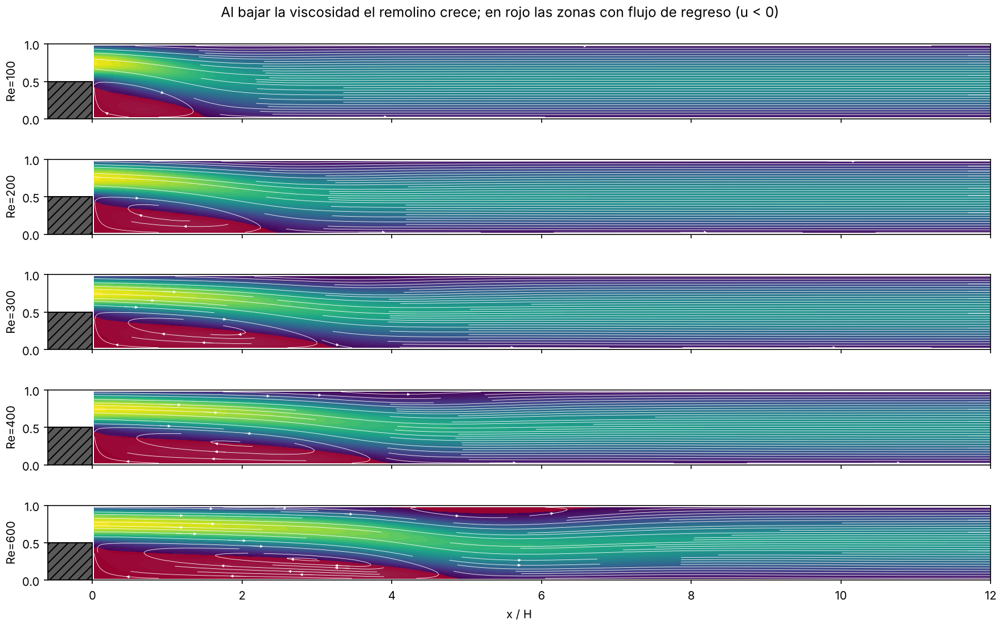
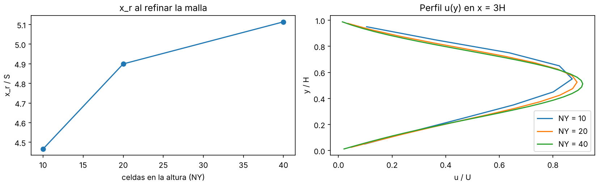
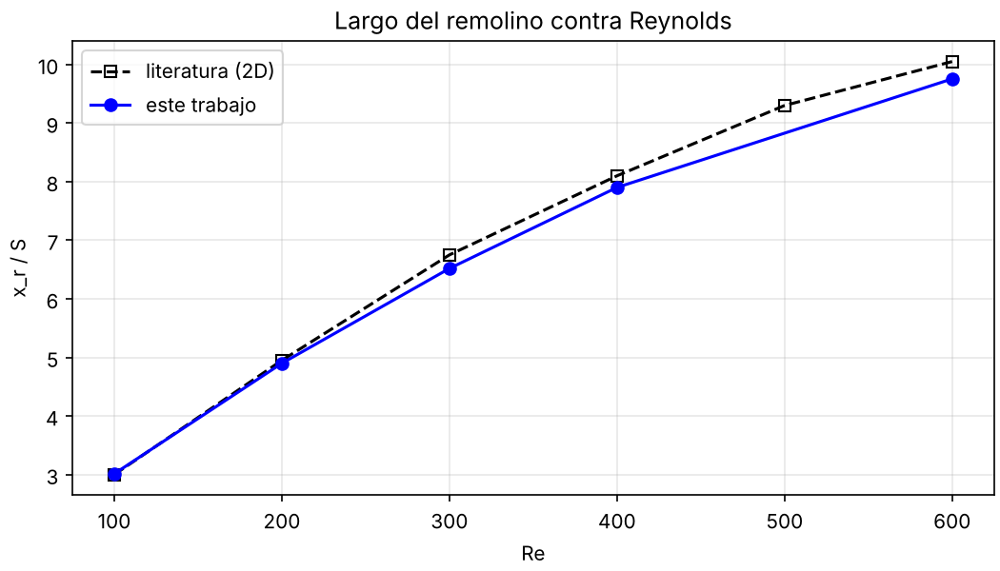

<div class="video">
**Video (YouTube):** <https://www.youtube.com/shorts/1UjPvbtYBLU>  
**Código:** `escalon_descendente.ipynb` (Ejecutar todo, ~3 min; sólo `numpy`, `scipy`, `matplotlib`)
</div>

## Resumen

Se simula el flujo bidimensional, incompresible y laminar en un canal con un escalón descendente de relación de
expansión 2, para números de Reynolds de 100 a 600. Las ecuaciones de Navier–Stokes se resuelven con un código propio
en Python: volúmenes finitos en malla escalonada (MAC), método de proyección de Chorin con Euler explícito y ecuación de
Poisson para la presión resuelta por factorización LU dispersa. El código conserva la masa a precisión de máquina
($\max|\nabla\cdot\mathbf u|\sim10^{-15}$). La longitud de reacoplamiento $x_r$ crece casi linealmente con $Re$
($x_r/S$ = 3.01, 4.90, 6.52, 7.90, 9.75 para $Re$ = 100–600) y desde $Re\approx400$ aparece una burbuja secundaria
en la pared superior. Se presenta un análisis paramétrico de viscosidad (Re), malla y paso de tiempo (límite de estabilidad), y se compara
con la literatura (diferencias menores a 3.5 %).

## 1. Introducción y descripción del fenómeno

El escalón descendente (*backward-facing step*, BFS) es el caso de prueba clásico de flujo separado: la geometría es
simple, pero el flujo tiene separación, recirculación, capa de corte libre y reacoplamiento, los mismos mecanismos que
aparecen en difusores, cámaras de combustión, intercambiadores y la parte trasera de vehículos.

Cuando el fluido llega a la esquina convexa, la capa límite no puede seguir el cambio brusco de geometría porque el
fluido cercano a la pared no tiene inercia para vencer el gradiente de presión adverso de la expansión. El flujo se
**separa** en la arista y forma una **capa de corte** con vorticidad intensa. Debajo de ella queda una **burbuja de
recirculación** con flujo inverso. La capa de corte se ensancha por difusión viscosa hasta tocar la pared inferior en
el **punto de reacoplamiento** $x_r$, donde el esfuerzo cortante en la pared cambia de signo ($\tau_w=0$). Aguas
abajo el perfil de velocidad se reorganiza en una parábola de Poiseuille que ocupa todo el canal.

Al aumentar $Re$ (menos viscosidad), el momento de la capa de corte se difunde más lento hacia la pared y la burbuja se
alarga. Para $Re\gtrsim400$, el gradiente de presión adverso es suficiente para separar también la capa límite de la
pared superior y aparece una **burbuja secundaria** (Armaly et al., 1983).

## 2. Planteamiento físico

### 2.1 Geometría y adimensionalización

Altura del canal aguas abajo $H$, altura del escalón $S=H/2$ y canal de entrada $h=H-S$, por lo que la relación de
expansión es $ER=H/h=2$. La entrada se coloca en el plano del escalón ($x=0$), como en el *benchmark* de Gartling (1990);
el dominio es $0\le x\le L$, $0\le y\le H$, con $L=15H$ a $30H$ según $Re$.

Se usa la velocidad media de entrada $U$, la altura $H$ y la presión dinámica $\rho U^2$ como escalas. El número de
Reynolds es
$$Re=\frac{UH}{\nu}=\frac{U\,(2h)}{\nu},$$
es decir, basado en el diámetro hidráulico del canal de entrada (definición de Armaly et al. y de Gartling).
Con $U=H=1$, $\nu=1/Re$: **variar la viscosidad es variar $Re$**.

### 2.2 Ecuaciones de gobierno

$$\nabla\cdot\mathbf u=0$$
$$\frac{\partial\mathbf u}{\partial t}+(\mathbf u\cdot\nabla)\mathbf u=-\nabla p+\frac1{Re}\nabla^2\mathbf u$$

En componentes y en forma conservativa (la que se discretiza):
$$\frac{\partial u}{\partial t}+\frac{\partial (u^2)}{\partial x}+\frac{\partial (uv)}{\partial y}=-\frac{\partial p}{\partial x}+\frac1{Re}\left(\frac{\partial^2u}{\partial x^2}+\frac{\partial^2u}{\partial y^2}\right)$$
$$\frac{\partial v}{\partial t}+\frac{\partial (uv)}{\partial x}+\frac{\partial (v^2)}{\partial y}=-\frac{\partial p}{\partial y}+\frac1{Re}\left(\frac{\partial^2v}{\partial x^2}+\frac{\partial^2v}{\partial y^2}\right)$$

### 2.3 Supuestos de modelado

1. Flujo bidimensional (canal infinitamente ancho en $z$).
2. Incompresible, $\rho$ constante; fluido newtoniano con $\mu$ constante; isotérmico.
3. Laminar ($Re\le600$); la transición en el BFS ocurre alrededor de $Re\approx1200$ (Armaly et al.).
4. Sin fuerzas de cuerpo: la gravedad sólo añade una presión hidrostática que no cambia la cinemática.

### 2.4 Condiciones iniciales y de frontera

| Frontera | Velocidad | Presión |
|---|---|---|
| Entrada $x=0$, $S<y<H$ | Poiseuille $u=6U\eta(1-\eta)$, $\eta=(y-S)/h$; $v=0$ | $\partial p/\partial n=0$ |
| Cara del escalón $x=0$, $0<y<S$ | no deslizamiento $u=v=0$ | $\partial p/\partial n=0$ |
| Paredes $y=0$ y $y=H$ | no deslizamiento $u=v=0$ | $\partial p/\partial n=0$ |
| Salida $x=L$ | $\partial u/\partial x=\partial v/\partial x=0$ | $p=0$ |

**Condición inicial:** fluido en reposo, $\mathbf u(x,y,0)=0$. Se integra en el tiempo hasta alcanzar el estado
estacionario. El perfil de entrada tiene velocidad media $U$ y máxima $1.5U$.

## 3. Método numérico

### 3.1 Malla escalonada (MAC)

La presión se almacena en el centro de cada celda, $u$ en las caras verticales y $v$ en las horizontales. Así el
gradiente de presión que mueve cada velocidad usa dos nodos vecinos directos y se evita el desacople
presión–velocidad ("tablero de ajedrez") sin necesidad de correcciones adicionales. Las condiciones de no deslizamiento para la
componente tangencial se imponen con celdas fantasma ($u_{fantasma}=-u_{interior}$).

{width=55%}

### 3.2 Método de proyección (paso fraccionado de Chorin)

Con $\mathbf R(\mathbf u)=\tfrac1{Re}\nabla^2\mathbf u-\nabla\cdot(\mathbf u\mathbf u)$, cada paso de tiempo hace:

1. **Predictor:** $\mathbf u^*=\mathbf u^n+\Delta t\,\mathbf R(\mathbf u^n)$
2. **Poisson:** $\nabla^2p^{n+1}=\dfrac{\nabla\cdot\mathbf u^*}{\Delta t}$
3. **Corrector:** $\mathbf u^{n+1}=\mathbf u^*-\Delta t\,\nabla p^{n+1}$

La matriz de Poisson (5 puntos, Neumann en entrada y paredes, Dirichlet en la salida) no cambia en el tiempo, así que
se factoriza una sola vez (LU dispersa de SciPy) y en cada paso sólo se hace una sustitución. El corrector deja la
divergencia discreta en cero a precisión de máquina.

### 3.3 Discretización espacial

Difusión: diferencias centrales de segundo orden (laplaciano de 5 puntos). Convección: en forma conservativa, como
"lo que sale menos lo que entra" por las caras del volumen de control, por ejemplo
$$\left.\frac{\partial(u^2)}{\partial x}\right|_i\approx\frac{u_e\,u_{cara,e}-u_w\,u_{cara,w}}{\Delta x},\qquad
u_{cara,e}=\frac{u_i+u_{i+1}}2-\frac{\gamma}{2}\,\mathrm{signo}(u_e)\,(u_{i+1}-u_i).$$
Es decir, el valor en la cara es el promedio de los vecinos corrido hacia el lado de donde viene el flujo. Con
$\gamma=0$ es el promedio puro (preciso pero inestable con Euler explícito) y con $\gamma=1$ es *upwind* (estable pero con
difusión numérica). Se usa $\gamma=0.5$.

### 3.4 Estabilidad y convergencia

Para Euler explícito:
$$\Delta t\le\min\left(\frac{\Delta x}{|u|_{max}},\;\frac{Re}2\left(\frac1{\Delta x^2}+\frac1{\Delta y^2}\right)^{-1}\right),$$
(CFL convectivo y número de Fourier difusivo). Por defecto se usa el 50 % del límite. Se declara estado estacionario cuando $\max|\mathbf u^{n+1}-\mathbf u^n|/\Delta t<10^{-5}$.

### 3.5 Post-proceso

$x_r$ se obtiene como el cruce de $-$ a $+$ de $\tau_w\propto u$ en la primera celda junto a la pared inferior, aguas
abajo del mínimo de $u$ (así no se confunde con el pequeño vórtice de esquina). La burbuja secundaria se detecta igual
en la pared superior. Se calcula también la vorticidad $\omega=\partial v/\partial x-\partial u/\partial y$.

## 4. Resultados: caso base Re = 200

Con 20 celdas por $H$ (6000 celdas) y $\Delta t=0.0167$, el estado estacionario se alcanza en $t=48.6\,H/U$
(2916 pasos, ~4 s de CPU). El reacoplamiento ocurre en $x_r=2.45H$ ($x_r/S=4.90$).


La vorticidad se concentra en la capa de corte que nace en la arista ($\omega<0$) y en la pared superior ($\omega>0$).
La presión es mínima cerca del escalón y **aumenta** aguas abajo hasta $x\approx3H$: es la recuperación de presión de la
expansión súbita, un gradiente adverso que es justamente la causa de la separación. Después cae linealmente como en un
flujo de Poiseuille desarrollado.


Por conservación de masa la velocidad máxima baja de $1.5U$ (canal de entrada) a $0.75U$ (canal completo).

## 5. Análisis paramétrico

### 5.1 Viscosidad (número de Reynolds)

| $Re$ | $\nu$ | $x_r/S$ | Burbuja superior $x_s/S$ – $x_e/S$ |
|---:|---:|---:|---|
| 100 | 0.0100 | 3.01 | — |
| 200 | 0.0050 | 4.90 | — |
| 300 | 0.0033 | 6.52 | — |
| 400 | 0.0025 | 7.90 | 7.9 – 8.1 (incipiente) |
| 600 | 0.0017 | 9.75 | 8.0 – 13.4 |




Al bajar la viscosidad la burbuja principal se alarga casi linealmente con $Re$ hasta ~400 y después crece más lento,
cuando aparece la burbuja superior: ésta estrecha el paso del flujo principal, lo empuja hacia abajo y limita el
crecimiento de la burbuja inferior. El mínimo de $\tau_w$ dentro de la burbuja se hace menos negativo con $Re$ porque
$\tau_w\propto\nu$.

### 5.2 Malla

| Celdas por $H$ | Celdas totales | $x_r/S$ | CPU |
|---:|---:|---:|---:|
| 10 | 1 500 | 4.466 | 0.5 s |
| 20 | 6 000 | 4.899 | 3.8 s |
| 40 | 24 000 | 5.114 | 37 s |

Cada vez que se duplica la malla, el cambio en $x_r$ se reduce a la mitad (+0.43 y luego +0.21), así que el valor con
malla infinitamente fina estaría cerca de $x_r/S\approx5.3$ y el error con 20 celdas/$H$ es de ~8 %. El costo crece ~10×
por cada refinamiento (4× celdas y 2× pasos por el CFL).



### 5.3 Paso de tiempo y estabilidad

Para $Re=200$ y 20 celdas/$H$: $\Delta t_{CFL}=0.033$ y $\Delta t_{Fo}=0.125$, de modo que manda el CFL.

| $\Delta t$ | $\Delta t/\Delta t_{CFL}$ | Resultado | Pasos | $x_r/S$ |
|---:|---:|---|---:|---:|
| 0.0050 | 0.15 | converge | 9721 | 4.899 |
| 0.0167 | 0.50 | converge | 2910 | 4.899 |
| 0.0300 | 0.90 | converge | 1620 | 4.899 |
| 0.0450 | 1.35 | **diverge** en 22 pasos | — | — |


El estado estacionario es **independiente de $\Delta t$** mientras el esquema sea estable; un $\Delta t$ mayor sólo
reduce el número de pasos. Por encima del límite CFL el error crece exponencialmente y la solución explota.

## 6. Validación



| $Re$ | Este trabajo | Referencia 2D | Error |
|---:|---:|---:|---:|
| 100 | 3.01 | 3.00 | +0.5 % |
| 200 | 4.90 | 4.95 | −1.0 % |
| 300 | 6.52 | 6.75 | −3.4 % |
| 400 | 7.90 | 8.10 | −2.5 % |
| 600 | 9.75 | 10.05 | −2.9 % |


Las diferencias son menores a 3.5 % y se reproduce el remolino del techo a partir de $Re\approx400$. Parte del buen
acuerdo es cancelación de errores: según el estudio de malla, con una malla muy fina $x_r$ subiría ~8 %. Para un resultado
más exacto habría que usar más celdas.

## 7. Conclusiones

1. Se resolvió Navier–Stokes 2D con el método de proyección (velocidad de prueba → presión → corrección); la masa se
   conserva a precisión de máquina.
2. La simulación muestra la separación en la esquina, la recirculación, el reacoplamiento y, para $Re\gtrsim400$, la
   burbuja secundaria en el techo.
3. Bajar la viscosidad (subir $Re$) alarga la burbuja: $x_r/S$ pasa de 3 a casi 10 entre $Re=100$ y 600.
4. El resultado converge al refinar la malla; con 20 celdas/$H$ el error es de ~8 %.
5. $\Delta t$ no cambia la solución estacionaria si se respeta el CFL; por encima de él el método explícito diverge.

## Referencias

1. Armaly, B. F., Durst, F., Pereira, J. C. F., Schönung, B. (1983). Experimental and theoretical investigation of backward-facing step flow. *J. Fluid Mech.* 127, 473–496.
2. Gartling, D. K. (1990). A test problem for outflow boundary conditions — flow over a backward-facing step. *Int. J. Numer. Methods Fluids* 11, 953–967.
3. Chorin, A. J. (1968). Numerical solution of the Navier–Stokes equations. *Math. Comp.* 22, 745–762.
4. Griebel, M., Dornseifer, T., Neunhoeffer, T. (1998). *Numerical Simulation in Fluid Dynamics: A Practical Introduction*. SIAM.
5. Roache, P. J. (1994). Perspective: a method for uniform reporting of grid refinement studies. *J. Fluids Eng.* 116, 405–413.
6. arXiv:2507.16509 (2025). A Finite Volume and Levenberg–Marquardt Optimization Framework for Benchmarking MHD Flows over Backward-Facing Steps (Tabla 1).
7. kangluosee. *CFD-Python: Combined backward facing step* (GitHub). Referencia del problema; el código de este proyecto se escribió desde cero.

## Anexo: uso del código

```
pip install numpy scipy matplotlib jupyter
jupyter notebook escalon_descendente.ipynb      # Kernel → Restart & Run All
```

Los parámetros de la demostración en vivo (`RE`, `NY`, `L`) están en el bloque 0.
Las figuras se guardan en `figures/`.
